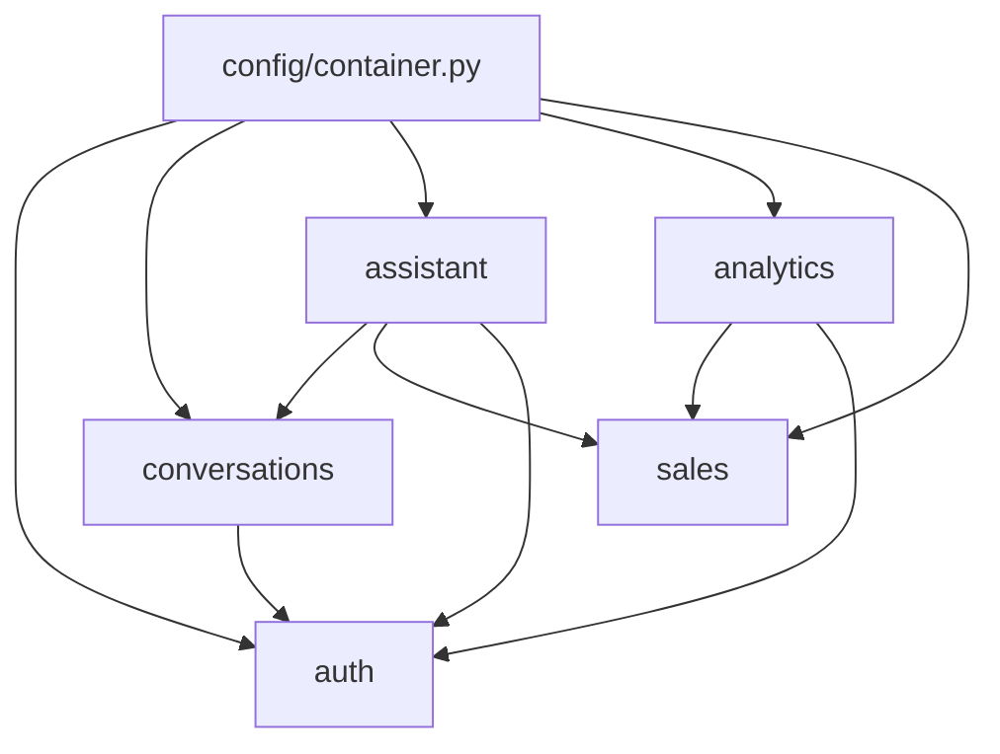

# Backend: modular monolith và Clean Architecture

Backend chia theo module nghiệp vụ. Mỗi module sở hữu use case, domain contract, adapter và HTTP API của mình. Các module vẫn chạy trong một FastAPI process và dùng một PostgreSQL database; việc tách module phục vụ quản lý và mở rộng code, không tự tăng năng lực xử lý hay biến hệ thống thành microservices.

## Cấu trúc

```text
backend/
├── main.py                         # FastAPI, CORS, lifespan; mount router tổng
├── config/
│   ├── container.py                # Composition root kết nối các module
│   ├── config_manager.py
│   └── settings.py
├── src/
│   ├── modules/
│   │   ├── auth/                   # Đăng nhập, guest JWT, refresh, staff/admin
│   │   ├── conversations/          # Lịch sử, ownership, đọc/đổi tên/xóa
│   │   ├── assistant/              # Chat/SSE, LangGraph, Text-to-SQL, RAG
│   │   ├── analytics/              # Dashboard, đơn hàng, công nợ, xuất Excel
│   │   └── sales/                  # Đồng bộ khách hàng, bán/trả hàng, sổ công nợ
│   ├── common/
│   │   ├── container.py            # PostgreSQL và session factory chung
│   │   ├── errors/                 # Nhóm lỗi phổ biến và template, thuần Python
│   │   ├── domain/                # Tiện ích thời gian Việt Nam, DateRange
│   │   ├── infrastructure/database/ # PostgresClient và SQLAlchemy Base
│   │   └── utils/                 # Singleton metaclass
│   └── bootstrap/
│       ├── orm.py                  # Đăng ký toàn bộ model cho Alembic
│       └── router.py               # Router tổng, prefix/tag và danh sách module cần wire
├── migrations/                     # Lịch sử schema dùng chung
├── etl_business/                    # Trích xuất/chuẩn hóa nguồn Excel/MDB
├── evals/                           # Benchmark execution accuracy
└── tests/
    ├── unit/
    │   ├── test_module_architecture.py
    │   └── test_module_composition.py
    └── integrate/
```

Một module có cấu trúc:

```text
module/
├── domain/         # Entity/value object, repository/service interface, error
├── application/    # Use case, service, orchestration
├── infrastructure/ # Repository, ORM, SDK adapter, workbook exporter
├── presentation/   # Router và DTO nếu có HTTP endpoint
└── container.py    # Wiring nội bộ; dependency bên ngoài được inject qua port
```

Chỉ tạo layer khi module thực sự có code cho layer đó. Module sales hiện được gọi qua CLI/ETL và không có HTTP router riêng.

## Quy ước đặt tên và nhóm file

- File/thư mục dùng snake_case; class dùng PascalCase. Tên file thể hiện trách nhiệm và khớp với class chính: text_to_sql_use_case.py / TextToSQLUseCase, text_to_sql_tool.py / TextToSQLTool, tool_result.py / ToolResult.
- domain/ports/ chứa interface cho LLM, cache, embedding, vector DB, SQL executor, bảo mật và workbook exporter. domain/repositories/ giữ các repository contract. domain/services/ chỉ nên được tạo khi có domain service thực sự, không dùng làm tên khác cho các port.
- assistant/application/prompts/sql_prompts.py và response_prompts.py chứa prompt LLM. assistant/domain/constants/query_analysis_rules.py chứa QueryAnalysisRules, là tập quy tắc phục vụ phân tích câu hỏi.
- assistant/application/use_cases/search_documents_use_case.py và domain/entities/search_documents_result.py dùng số nhiều tương ứng với SearchDocumentsUseCase / SearchDocumentsResult.
- analytics/domain/models/ nhóm filter, enum, value object và kết quả truy vấn theo nghiệp vụ: dashboard.py, overview.py, customer_debt.py, orders.py, order_ledger.py. Đây là các kiểu dữ liệu thuần Python; ORM vẫn nằm trong infrastructure/models.py, DTO HTTP nằm trong presentation/dto/.
- Tên provider của pipeline SQL là text_to_sql_use_case và sql_executor. Tránh dùng analytics_use_case / analytics_repository trong assistant vì dễ nhầm với module analytics.

## Quy tắc dependency



Trong mỗi module:

- presentation gọi application, sử dụng DTO và domain value object.
- application điều phối nghiệp vụ thông qua domain interface; không import infrastructure/presentation hoặc config/container.py.
- domain chỉ phụ thuộc thư viện chuẩn và domain contract; không import FastAPI, SQLAlchemy hay SDK.
- infrastructure triển khai domain interface. Container của module ghép các implementation với use case.
- config/container.py kết nối module với nhau và inject tài nguyên chung. Container của module không import container module khác.
- common không phụ thuộc module nghiệp vụ. Không đưa code vào common chỉ vì muốn né ranh giới module.

Các nhóm lỗi dùng chung nằm trong `src/common/errors/`: `not_found`, `not_permission`, `unauthorized`, `validation`, `conflict`, cấu hình, timeout và lỗi dịch vụ/nội bộ. Mỗi module gom mã lỗi và mẫu thông điệp riêng trong `domain/errors.py`; nơi gọi khởi tạo lỗi có tên kèm tham số có tên. Ánh xạ sang HTTP status nằm tại `src/common/presentation/error_handlers.py`, giữ nguyên response `{"detail": ...}` và contract SSE. Lỗi domain không phụ thuộc framework. Xem `src/common/errors/README.md`.

Application có thể dùng domain contract của module khác: assistant sử dụng IConversationRepository, repository contract của sales và IDashboardAnalyticsRepository cùng domain service `period_comparison` của analytics (câu hỏi có sẵn của Tổng quan được trả lời từ đúng số liệu dashboard). Repository analytics được inject vào assistant tại config/container.py. Các HTTP adapter dùng dependency xác thực từ auth và ownership guard từ conversations.

Hai dependency hạ tầng phục vụ đọc được cho phép rõ ràng: analytics query các ORM model của sales để tổng hợp báo cáo; conversation repository join UserModel của auth để hiển thị chủ hội thoại. Không cho application/domain truy cập các ORM model này. Nếu tách database/service trong tương lai, thay các read adapter này bằng projection hoặc API port; chưa có tính độc lập về triển khai/database.

LangGraph nằm trong application của assistant vì đây là cơ chế orchestration hiện tại. RapidFuzz và pandas vẫn là thư viện xử lý dữ liệu của các application service hiện có. Adapter truy cập dịch vụ ngoài, JWT/bcrypt, SQLAlchemy, Redis, Milvus, LLM và OpenPyXL nằm trong infrastructure.

## Điểm vào và DI

src/bootstrap/router.py tập hợp bốn router auth/conversations/assistant/analytics dưới /api/v1, khai báo prefix/tag và các endpoint public /health, /. ROUTER_MODULES trong cùng file liệt kê module cần DI wiring. main.create_app() cấu hình container, wire ROUTER_MODULES rồi mount router tổng. CLI create_admin.py và sync_business_data.py tiếp tục dùng config.container.container.

Pydantic Settings parse/merge/validate theo environment → backend/.env → YAML được chọn → defaults. ConfigManager chỉ chọn file và cache model; YAML được chọn bằng argument hoặc AI_ASSISTANT_CONFIG_FILE, fallback local development duy nhất là config/local.yml nếu có. Secrets dùng SecretStr và chỉ được giải mã tại settings.to_container_config() khi truyền cho DI. PostgreSQL URL được tạo bằng URL.create(); Alembic và backend cùng đọc DatabaseSettings, không lấy DSN riêng từ alembic.ini. Xem config/README.md cho tên env, source precedence và validation.

Tên provider phẳng hiện có (auth_use_case, chat_use_case, dashboard_analytics_use_case, v.v.) được giữ làm alias đến provider trong module để CLI và test override tiếp tục dùng được. Code mới có thể truy cập container.auth(), container.sales(), container.assistant(), v.v. để kiểm tra wiring của một module. Không khởi tạo adapter trực tiếp trong router hoặc use case.

TextToSQLUseCase của assistant nhận ISQLExecutor từ domain/ports/i_sql_executor.py; PostgresSQLExecutor tại infrastructure/database/postgres_sql_executor.py triển khai port và giữ transaction chỉ đọc cùng statement timeout. AuthUseCase nhận IPasswordHasher và ITokenService từ auth/domain/ports/; BcryptPasswordHasher và JWTTokenService nằm trong auth/infrastructure/security.py. JWT vẫn dùng HS256, kiểm tra issuer/audience/expiry/type; refresh token tiếp tục rotate qua repository.

## Persistence và migration

Mỗi module sở hữu models.py trong infrastructure:

| Module | Bảng |
| --- | --- |
| auth | users, refresh_tokens |
| conversations | conversations, messages |
| sales | customers, sales_invoices, sales_invoice_lines, sales_returns, sales_return_lines, customer_debt_transactions |

Tất cả kế thừa src.common.infrastructure.database.base.Base. src/bootstrap/orm.py import mọi model vào một metadata registry; migrations/env.py import registry này. Khi thêm ORM model, thêm import vào registry để Alembic nhận đủ metadata và foreign key.

Alembic là nguồn sự thật cho schema; head hiện tại là e7b3c5a19f42. Mọi thay đổi bảng/cột/index/constraint phải có revision mới. Không gọi create_all khi khởi động.

Tiền giữ Decimal/numeric; công nợ dùng signed ledger customer_debt_transactions.

## Thêm tính năng hoặc module

1. Chọn module sở hữu nghiệp vụ. Thêm domain contract trước nếu cần dependency mới.
2. Viết use case với dependency inject; triển khai adapter trong infrastructure của module sở hữu dữ liệu/tích hợp.
3. Khai báo provider trong container.py của module. Kết nối dependency liên module tại config/container.py.
4. Nếu có HTTP API, thêm DTO/router và đăng ký tại src/bootstrap/router.py (gồm ROUTER_MODULES cho DI wiring); cập nhật frontend contract khi API thay đổi.
5. Nếu đổi schema, thêm migration. Kiểm tra metadata registry khi thêm module/model.
6. Chạy test liên quan và kiểm tra kiến trúc, sau đó chạy suite backend.

Không có package shim cho đường dẫn import cũ (src.application.*, src.domain.*, src.infrastructure.*, src.presentation.*, src.utils.*, src.shared.*). Dùng src.modules.<module>.* hoặc src.common.*; container dùng chung là CommonContainer/container.common.

## Kiểm tra

Chạy từ backend/:

```powershell
.\env\Scripts\python.exe -m pytest tests/unit/test_module_architecture.py tests/unit/test_module_composition.py
.\env\Scripts\python.exe -m pytest tests/unit tests/integrate etl_business/tests
.\env\Scripts\python.exe -m alembic heads
```

Architecture test kiểm tra hướng phụ thuộc layer, domain không dùng framework, dependency liên module không vòng, common không import nghiệp vụ và đường dẫn import nội bộ còn tồn tại. Composition test kiểm tra provider dùng chung/override xuyên module và metadata/foreign key đầy đủ. Các test xác thực, guest, ownership, SSE, SQL, analytics và xuất workbook tiếp tục kiểm tra hành vi.
