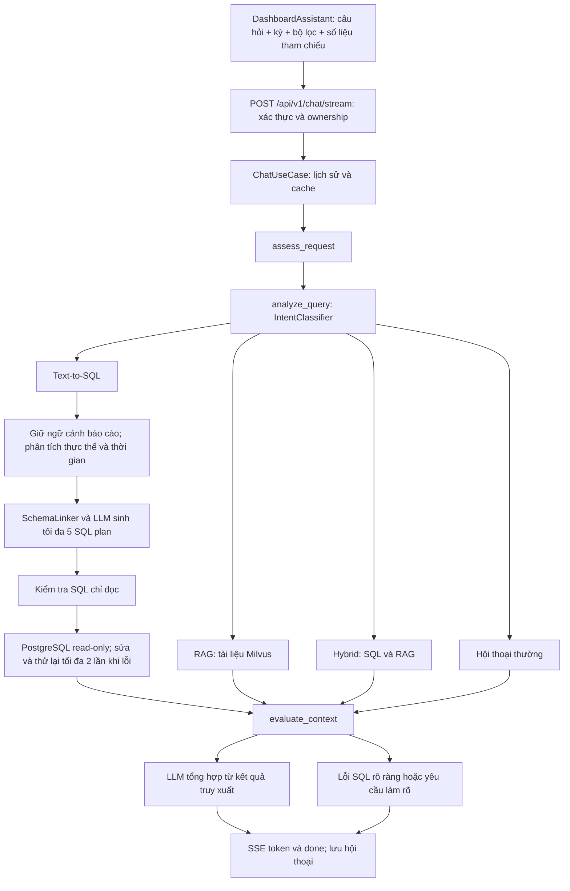

# Luồng agent và phân tích kết quả kinh doanh

Rà soát ngày 18/10/2026 theo câu hỏi: “Phân tích kết quả kinh doanh và các biến động đáng chú ý trong kỳ đang chọn”, kỳ 01/01/2026–18/10/2026, tất cả khách hàng/địa bàn.

## Luồng thực tế

Luồng không streaming dùng graph đầy đủ, có bước kiểm tra câu trả lời và thử tạo lại khi thiếu citation. Streaming chạy context graph rồi phát token; citation chỉ được kiểm tra sau khi phát. Kiểm tra citation hiện là kiểm tra source ID xuất hiện trong câu trả lời, chưa phải xác minh từng con số/khẳng định.

## Vấn đề và sửa đổi

| Vấn đề trong code trước sửa | Hành vi sau sửa |
| --- | --- |
| Trích xuất tên khách trên toàn bộ message, gồm cả danh sách khách giảm mua tham chiếu | Tách câu hỏi chính và ngữ cảnh; chỉ lấy UUID/địa bàn được chọn làm bộ lọc báo cáo |
| Khoảng ngày dashboard chỉ còn gợi ý năm; bước viết lại câu hỏi có thể bỏ ngữ cảnh | Giữ nguyên block ngữ cảnh khi viết lại; truyền cận ngày đóng/mở chính xác, ví dụ `< 2026-10-19` |
| Quy tắc tháng 10–12, tháng bằng chữ và quý La Mã nhận diện sai; ngày tương đối cố định từ khi import | Sửa nhận diện và tính ngày Việt Nam ở mỗi request |
| Yêu cầu tổng hợp chưa có kế hoạch dữ liệu rõ ràng | Prompt yêu cầu KPI/so sánh kỳ, xu hướng, khách tăng/giảm mua, địa bàn, công nợ và độ phủ dữ liệu, tối đa 5 plan |
| Mọi lần sinh SQL/JSON và trả lời chỉ được 1.000 completion token | Ngân sách nội bộ 8.192, câu trả lời 4.096; từ chối output rỗng/bị cắt; không tách SQL từ JSON hỏng |
| Lỗi SQL bị định dạng thành “Không có dữ liệu”, rồi chuyển sang RAG hoặc hỏi người dùng bổ sung thông tin | Phân biệt truy vấn thành công không có dòng với lỗi truy vấn; trả thông báo lỗi an toàn, không dùng tài liệu thay số liệu SQL thất bại |
| Metadata có thể ghi SQL gốc sau khi thực tế đã chạy SQL sửa | Ghi SQL cuối cùng đã sửa; giữ số Decimal khi tìm cực trị |
| Khởi tạo agent đã kết nối Milvus, khiến SQL cũng phụ thuộc vector DB hoạt động | Chỉ kết nối Milvus khi thực hiện thao tác vector đầu tiên |

Kế hoạch phân tích nhiều chỉ số hiện vẫn được LLM sinh SQL theo prompt, chưa phải bộ công cụ analytics cố định. Graph hiện không có bước replan (đã xóa node không có đường vào), chưa phân rã nhiệm vụ hoặc tự tìm thêm dữ liệu. Dashboard đã có truy vấn deterministic trong module analytics nhưng agent chưa gọi trực tiếp các truy vấn đó. Vì vậy kiểm thử giả lập chưa chứng minh chất lượng SQL do mô hình sinh ra.

## Bằng chứng và giới hạn xác minh

- Kiểm tra local chỉ đọc: PostgreSQL truy cập được, có 33.655 hóa đơn đang hoạt động. Ngày hóa đơn mới nhất là **20/08/2026**. Đây là độ phủ hóa đơn, không phải xác nhận ETL đã hoàn tất hoặc toàn bộ loại giao dịch đều kết thúc ngày đó.
- Kỳ báo cáo kết thúc 18/10/2026 nên cần nói rõ phần thời gian chưa có hóa đơn; không kết luận đó là suy giảm kinh doanh đã được xác nhận.
- Cấu hình local lúc rà soát chọn `gpt-5.4-nano`. Giới hạn 1.000 token là rủi ro output thiếu/rỗng; chưa có lần gọi LLM thực được phép để khẳng định đây là nguyên nhân trực tiếp của câu hỏi trên.
- Kiểm thử hồi quy dùng LLM/SQL giả lập cho câu hỏi nguyên văn, phạm vi ngày, bộ lọc UUID/địa bàn, số liệu tham chiếu, nhiều plan, SQL repair, lỗi SQL, SSE và lazy connection Milvus. Bộ unit và integration cũng kiểm tra lại authorization/ownership.
- Chưa xác nhận chất lượng câu trả lời đầu cuối với nhà cung cấp LLM. Lần tái hiện thực bị automatic approval review chặn vì có thể gửi lược đồ/ngữ cảnh kinh doanh ra ngoài. Cần sự cho phép cho bước này; không thể coi kiểm thử giả lập là bằng chứng AI đã trả lời đúng trên dữ liệu thật.

Thay đổi code cần restart backend đang phục vụ. Không đổi model hoặc secret, không cập nhật dữ liệu thật, schema hay API contract.
