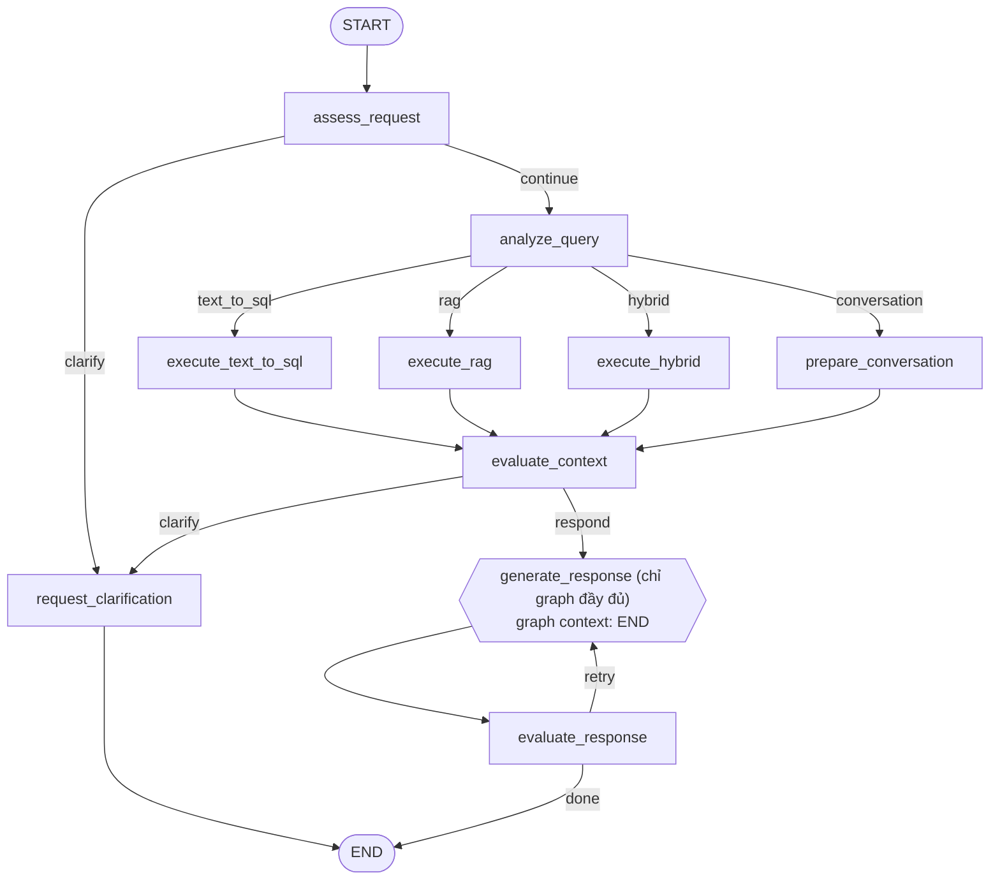

# Agent graph (LangGraph)

Tài liệu mô tả topology agent trong `src/modules/assistant/application/agent/`, đối chiếu code ngày 2026-11-17. Khi mâu thuẫn, code là nguồn đúng.

| Thành phần | File |
| --- | --- |
| Lắp graph | `agent/graph/builder.py` (`build_agent_graph`, `build_context_graph`, `_build_graph`) |
| Node | `agent/graph/nodes.py` (các factory `make_*_node`) |
| Hàm routing | `agent/graph/edges.py` |
| State | `agent/graph/state.py` (`AgentState`, `TypedDict`) |
| Timeout/retry, metric node | `agent/runtime.py` (`run_with_policy`, `node_metric`) |
| Facade cho use case | `agent/agent_service.py` (`AgentService`) |
| Tool | `agent/tools/` (`BaseTool`, `ToolResult`, `TextToSQLTool`, `RAGTool`) |
| Wiring | provider `agent_service` trong `src/modules/assistant/container.py` |

## Hai graph, một topology

`_build_graph` là factory duy nhất; `AgentService.__init__` dựng hai graph từ cùng các dependency:

- `_graph` = `build_agent_graph(..., include_response=True)`: có thêm node `generate_response` và `evaluate_response`. Dùng bởi `AgentService.invoke`, gọi từ `ChatUseCase.execute` (`POST /chat`).
- `_context_graph` = `build_context_graph(..., include_response=False)`: không có hai node trên; nhánh `respond` kết thúc ở `END`. Dùng bởi `AgentService.invoke_for_context`, gọi từ `ChatUseCase.execute_stream` (`POST /chat/stream`); sau đó token được sinh ở ngoài graph bằng `AgentService.stream_response`.

## Sơ đồ

Node `replan` và các trường state chỉ phục vụ nó (`plan`, `attempted_routes`, `iteration`, `max_iterations`, `awaiting_approval`, `pending_action`) đã bị xóa vì không có đường vào và không có nơi đọc.

## State (`AgentState`)

Khởi tạo đầy đủ mọi khóa trong `AgentService._make_initial_state`.

| Nhóm | Khóa |
| --- | --- |
| Đầu vào | `query`, `messages` (lịch sử `Message`) |
| Routing | `route` (`text_to_sql` / `rag` / `hybrid` / `conversation`) |
| Thực thi tool | `analyzed` (`AnalyzedQuery`), `tool_name`, `tool_result`, `tool_success`, `tool_error_code`, `tool_calls`, `sql_query` (danh sách SQL), `context`, `citations` |
| Đánh giá | `evaluation` (`{"decision", "reason", ...}`), `needs_clarification`, `clarification_question`, `response_attempts` |
| Đầu ra | `response` |
| Quan sát | `trace_id` (uuid4), `node_metrics` |

`BaseTool.requires_approval` chưa được graph đọc. Metadata trả về API (`ChatUseCase._build_metadata`) vẫn giữ các khóa cũ `plan` (`[]`), `iteration` (`0`), `awaiting_approval` (`False`), `pending_action` (`None`) với giá trị cố định để không vỡ contract.

## Node

Mọi node chạy qua `_run_node` -> `run_with_policy` (`asyncio.wait_for` + retry với backoff `min(0.25 * 2^attempt, 1.0)` giây), ghi `node_metrics` và log `trace_id`. Timeout hết hạn ném `AgentOperationTimeout`. Chỉ lỗi tạm thời được retry: timeout, `ExternalServiceError`, `ConnectionError`; lỗi domain/validation và lỗi lập trình ném ngay. Giới hạn: `wait_for` không hủy được việc chạy trong `asyncio.to_thread` (thread vẫn chạy tiếp nền), nên thao tác bọc trong thread phải chỉ đọc/idempotent. Ngoài timeout từng node, mỗi lượt có trần tổng: 120s (`invoke_for_context`) và 240s (`invoke`), quá hạn ném `AgentOperationTimeout`.

| Node | Việc làm | Timeout / retry |
| --- | --- | --- |
| `assess_request` | `needs_clarification` nếu câu hỏi rỗng, hoặc là một trong tập mơ hồ (`cái đó`, `việc đó`, `thế nào`, `còn nó`, `như thế nào`) khi chưa có lịch sử | 2s |
| `request_clarification` | Đặt `response` = câu hỏi làm rõ (mặc định nếu chưa có) | 2s |
| `analyze_query` | `query_analyzer.ensure_fresh()` rồi `classifier.classify` -> `route` | 15s |
| `prepare_conversation` | Dựng `context` hội thoại (`has_data=True`, `response_mode="conversation"`, `HISTORY_WINDOW` = 5 tin gần nhất) | 2s |
| `execute_text_to_sql` | `contextualizer.resolve` -> `query_analyzer.analyze` -> `TextToSQLTool.run`; citation `sql:N` | 45s |
| `execute_rag` | Dùng `analyzed` có sẵn hoặc phân tích mới; `RAGTool.run`; citation `doc:<doc_id>` | 30s, retry 1 |
| `execute_hybrid` | `asyncio.gather` SQL và RAG, gộp `retrieved_text`, citation SQL + doc | 50s |
| `evaluate_context` | Quyết định `respond` / `clarify` (xem dưới) | 2s |
| `generate_response` | `llm_service.generate_response`; nếu `response_mode == "tool_error"` thì trả `response` có sẵn, `response_attempts=1` | 60s, retry 1 |
| `evaluate_response` | Kiểm tra citation (xem dưới) | 2s |

Phân loại route (`IntentClassifier.classify`, `application/services/intent_classifier.py`) có nhánh quy tắc/từ khóa và nhánh LLM; chi tiết nằm trong file đó.

### `evaluate_context`

1. `context.has_data` -> `respond` (`grounded_context_available`).
2. `tool_name == "text_to_sql"` và `tool_success` (kể cả 0 dòng) -> `respond` (`sql_completed_without_matching_rows`); kết quả SQL rỗng vẫn có thẩm quyền, không chuyển sang RAG.
3. `text_to_sql` thất bại -> `respond` (`sql_tool_failed`), đặt `context.response_mode="tool_error"` và `response` = thông điệp lỗi SQL + " Vui lòng thử lại sau."
4. Còn lại -> `clarify` (`insufficient_grounding`) kèm câu hỏi bổ sung phạm vi thời gian/khách hàng/mặt hàng/số phiếu.

### `evaluate_response` (chỉ graph đầy đủ)

`source_ids` là các `citations[].id` (bỏ qua khi `response_mode == "tool_error"`). Thiếu citation nghĩa là có `source_ids` nhưng response không chứa `[id]` nào. Nếu response rỗng hoặc thiếu citation và `response_attempts < 2` -> `retry_response` (gắn `context.verification_feedback`), graph quay lại `generate_response`. Ngược lại -> `done` với `citation_verified`. Tối đa một lần sinh lại.

## Hàm routing (`edges.py`)

| Hàm | Trả về | Dùng ở |
| --- | --- | --- |
| `route_after_request_assessment` | `clarify` nếu `needs_clarification`, ngược lại `continue` | sau `assess_request` |
| `route_after_analysis` | `state["route"]` hoặc `rag` nếu thiếu | sau `analyze_query` |
| `route_after_context_evaluation` | `evaluation.decision` nếu thuộc `respond`/`clarify`, mặc định `clarify` | sau `evaluate_context` |
| `route_after_response_evaluation` | `retry` nếu `decision == "retry_response"`, ngược lại `done` | sau `evaluate_response` |

## Khác biệt stream và `POST /chat`

| | `POST /chat` (`ChatUseCase.execute`) | `POST /chat/stream` (`execute_stream`) |
| --- | --- | --- |
| Graph | `_graph` (`thread_id = "full:<conversation_id>:<uuid4 hex>"`) | `_context_graph` (`thread_id = "context:<conversation_id>:<uuid4 hex>"`) |
| Sinh câu trả lời | node `generate_response` | ngoài graph: `AgentService.stream_response` (timeout 60s) phát từng token SSE; nếu bị cắt do giới hạn token, adapter nối thêm câu thông báo cắt ngắn |
| Đánh giá câu trả lời / sinh lại | Có, tối đa 1 lần sinh lại khi thiếu citation | Không; chỉ ghi `metadata.response_evaluation = {"citation_verified": ..., "mode": "streaming_post_check"}` |
| `tool_error` | lấy từ `generate_response` | `execute_stream` phát `response` sẵn có như một token |
| Làm rõ | `final_state.response` | phát status `clarification` rồi token câu hỏi |

Cả hai đều kiểm tra cache Redis trước khi chạy graph (xem `caching-redis.md`); cache hit bỏ qua hoàn toàn graph. Câu trả lời của `text_to_sql`/`hybrid` không được cache (số liệu đổi theo ETL, khóa cache lại gắn với từng hội thoại nên hầu như không hit); lỗi Redis không làm hỏng lượt chat.

Lưu tin nhắn: user + assistant được ghi trong một transaction bằng `add_messages`; tin user không mang metadata của assistant. Với stream, khi client ngắt kết nối/dừng (`CancelledError`/`GeneratorExit`), `ChatUseCase` lưu tin user và phần trả lời dở dang với metadata `{"interrupted": true}` (chạy trong task riêng được `shield`) rồi ném lại; nếu lưu lỗi sau khi đã stream hết thì phát event `error` thay cho `done`.

## Nhánh guest

Guest không chạy graph. `ChatUseCase.authorize_guest_query` gọi `AgentService.classify_route` (chỉ classifier, không SQL/RAG); route khác `conversation` -> `GuestBusinessDataForbiddenError`. Sau đó `stream_stateless_conversation` dựng context cố định (không lịch sử, `has_data=False`, `response_mode="conversation"`, `max_completion_tokens=1536`) và stream trực tiếp từ LLM. Không đọc/ghi conversation repository, không dùng cache. Router từ chối guest bằng lỗi HTTP trước khi mở stream; `execute_guest_stream` luôn kết thúc bằng `done` hoặc `error`. `ChatRequest.message` giới hạn 1..4000 ký tự.

## Checkpointer, `MemorySaver` và `thread_id`

`AgentService` có tham số `checkpointer` nhưng `AssistantContainer.agent_service` không truyền nó, nên mỗi graph tự tạo một `MemorySaver()` (`checkpointer or MemorySaver()` trong `_build_graph`). Mỗi lượt gọi dùng `thread_id` duy nhất (`<tiền tố>:<conversation_id>:<uuid4 hex>`) và `AgentService._run_graph` gọi `checkpointer.adelete_thread(thread_id)` trong `finally`, nên checkpoint không tích lũy trong RAM. Lịch sử hội thoại thực tế đến từ PostgreSQL (`conversation.messages`), không từ checkpointer.

## Cách thêm node hoặc tool

Thêm tool:

1. Tạo class kế thừa `BaseTool` trong `agent/tools/`, trả `ToolResult` (`agent/tools/tool_result.py`). Đặt tên file theo class.
2. Khai báo `Singleton` trong `src/modules/assistant/container.py` và truyền vào `agent_service` (và `AgentService.__init__`, `build_agent_graph`, `build_context_graph`, `_build_graph`).
3. Tạo `make_execute_<tool>_node` trong `nodes.py`, bọc logic trong `_run_node` với timeout/retry; cập nhật `context`, `citations` (id dạng `loại:định-danh` để `evaluate_response` kiểm tra), `tool_calls`. Dùng các helper `_data_context`, `_sql_citations`, `_document_citations`, `_tool_call` trong `nodes.py`.

Thêm node/route:

1. Thêm giá trị vào `Literal` của `route` ở `state.py` và `Route` ở `intent_classifier.py`.
2. `graph.add_node(...)` và cạnh vào `evaluate_context` trong `_build_graph`; thêm khóa vào mapping của `route_after_analysis`.
3. Khóa state mới phải được thêm vào `AgentState` và `_make_initial_state`.
4. Nếu node ảnh hưởng guest: guest không đi qua graph; giữ nguyên rào chắn `authorize_guest_query`.
5. Test: `tests/unit/test_agent_phase1.py`, `tests/unit/test_agent_business_analysis.py`, và `tests/unit/test_module_architecture.py` khi đổi dependency.

Xem thêm `docs/agent-business-analysis.md` (prompt phân tích kinh doanh) và `docs/HYBRID_SEARCH.md` (nhánh RAG).
