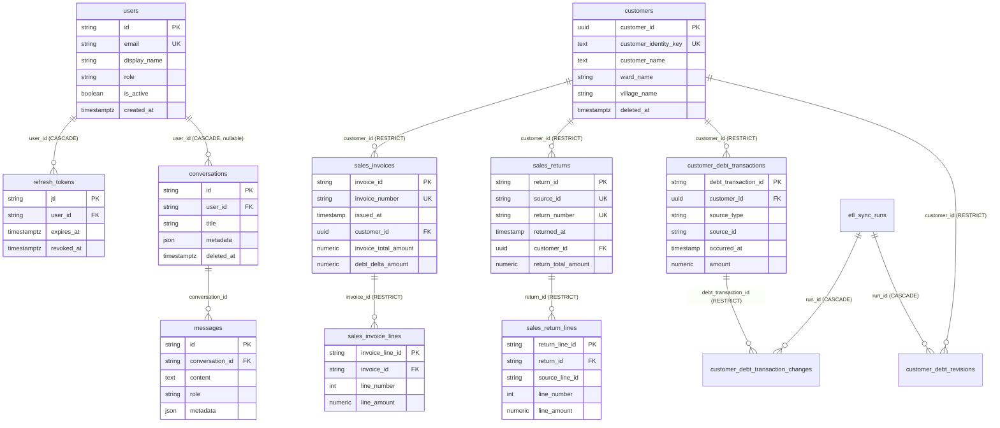

# Mô hình dữ liệu PostgreSQL

Tài liệu mô tả 13 bảng ORM hiện có, đối chiếu với code ngày 2026-11-20. Khi mâu thuẫn, ưu tiên code: model ORM tại `src/modules/*/infrastructure/models.py` và Alembic tại `migrations/versions/`. Alembic là nguồn sự thật của schema; không dùng `create_all` khi khởi động.

API đọc các bảng này được mô tả ở [analytics-api.md](analytics-api.md).

## 1. Sơ đồ quan hệ (ERD)

Có bốn nhóm bảng: xác thực (`users`, `refresh_tokens`), hội thoại (`conversations`, `messages`), dữ liệu bán hàng (6 bảng) và lưu vết ETL (`etl_sync_runs`, `customer_debt_transaction_changes`, `customer_debt_revisions`, xem mục 4.1). Bảng `alembic_version` do Alembic quản lý, không có ORM model.

## 2. Nhóm xác thực (`src/modules/auth/infrastructure/models.py`)

### `users`

| Cột | Kiểu | Ghi chú |
| --- | --- | --- |
| `id` | `varchar(36)` PK | UUID dạng chuỗi. |
| `email` | `varchar(320)` null | Unique + index; guest không có email. |
| `display_name` | `varchar(100)` not null | |
| `password_hash` | `varchar(255)` null | Null với guest. |
| `role` | `varchar(20)` not null | Mặc định `staff`; check `ck_users_role`: `guest`, `staff`, `admin`. |
| `is_active` | `boolean` not null | Mặc định `true`. |
| `created_at` | `timestamptz` not null | Mặc định `CURRENT_TIMESTAMP`. |
| `updated_at` | `timestamptz` null | |

### `refresh_tokens`

| Cột | Kiểu | Ghi chú |
| --- | --- | --- |
| `jti` | `varchar(36)` PK | Định danh token. |
| `user_id` | `varchar(36)` FK -> `users.id` | `ON DELETE CASCADE`, có index. |
| `expires_at` | `timestamptz` not null | Có index. |
| `created_at` | `timestamptz` not null | |
| `revoked_at` | `timestamptz` null | Đặt khi rotate/logout. |

## 3. Nhóm hội thoại (`src/modules/conversations/infrastructure/models.py`)

### `conversations`

| Cột | Kiểu | Ghi chú |
| --- | --- | --- |
| `id` | `varchar` PK | |
| `user_id` | `varchar(36)` FK -> `users.id` null | `ON DELETE CASCADE`, có index; chủ sở hữu hội thoại. |
| `title` | `varchar` null | |
| `metadata` | `json` null | Thuộc tính ORM là `extra_metadata`. |
| `created_at`, `updated_at` | `timestamptz` | Mặc định `CURRENT_TIMESTAMP`. |
| `deleted_at` | `timestamptz` null | Soft delete. |

### `messages`

| Cột | Kiểu | Ghi chú |
| --- | --- | --- |
| `id` | `varchar` PK | |
| `conversation_id` | FK -> `conversations.id` not null | Không khai báo `ondelete`. Index tổng hợp `ix_messages_conversation_id_created_at` (`conversation_id`, `created_at`) từ migration `e7b3c5a19f42`. |
| `content` | `text` not null | |
| `role` | `varchar` not null | `user` hoặc `assistant` (chỉ theo comment, không có check constraint). |
| `metadata` | `json` null | Chứa citation, kiểm tra citation, v.v. (`extra_metadata`). |
| `created_at`, `updated_at`, `deleted_at` | `timestamptz` | `deleted_at` là soft delete. |

Migration `f2b86c913e41` chuyển timestamp chat sang timezone-aware.

## 4. Nhóm bán hàng (`src/modules/sales/infrastructure/models.py`)

Quy ước chung: tiền là `Numeric(18, 2)`, số lượng `Numeric(18, 3)`, soft delete bằng `deleted_at`; truy vấn nghiệp vụ luôn lọc `deleted_at IS NULL`. Không chuyển qua float.

### `customers`

Grain: một dòng cho một danh tính khách hàng tạm thời.

| Cột | Kiểu | Ghi chú |
| --- | --- | --- |
| `customer_id` | `uuid` PK | `gen_random_uuid()`. |
| `customer_identity_key` | `text` not null | Unique `uq_customers_customer_identity_key`; là `tên|phường/xã|thôn/xóm` đã chuẩn hóa (trim, gộp khoảng trắng, lowercase) cho tới khi có mã khách hàng nguồn. |
| `customer_name` | `text` not null | Index `ix_customers_customer_name`. |
| `address_detail`, `village_name`, `ward_name` | text/varchar null | Địa bàn hiện tại của khách. |
| `created_at` | `timestamptz` not null | |
| `updated_at`, `deleted_at` | `timestamptz` null | |

Index một phần: `ix_customers_active_ward_name` (`ward_name`) và `ix_customers_active_village_name` (`village_name`), cùng điều kiện `deleted_at IS NULL`.

### `sales_invoices`

Grain: một hóa đơn bán.

| Cột | Kiểu | Ghi chú |
| --- | --- | --- |
| `invoice_id` | `varchar` PK | |
| `invoice_number` | `varchar` not null | Unique index `ux_sales_invoices_invoice_number`; khóa upsert của ETL. Tiền tố `XB` được dùng khi xuất nhật ký. |
| `issued_at` | `timestamp` (không timezone) not null | Giờ nghiệp vụ Việt Nam. |
| `customer_id` | `uuid` FK -> `customers` | `ON DELETE RESTRICT`, index `ix_sales_invoices_customer_id`. |
| `customer_name_snapshot`, `customer_address_detail_snapshot`, `customer_village_name_snapshot`, `customer_ward_name_snapshot` | text/varchar | Ảnh chụp thông tin in trên hóa đơn lịch sử. |
| `invoice_total_amount` | `numeric(18,2)` not null | Tổng có thẩm quyền ở cấp hóa đơn; check `>= 0`; không đảm bảo bằng tổng `line_amount`. |
| `debt_delta_amount` | `numeric(18,2)` null | Biến động nợ ghi trên hóa đơn. Không dùng để tính số dư công nợ hiện tại. |
| `created_at` | `timestamptz` | Mặc định `datetime.now(timezone.utc)` ở phía ORM; trước migration `d1e5b7a93c28` là `timestamp` không timezone (giá trị UTC). |
| `deleted_at` | `timestamptz` null | |

Index khác: index một phần `ix_sales_invoices_active_issued_at` (`issued_at` khi `deleted_at IS NULL`); index đầy đủ `ix_sales_invoices_issued_at` đã bị bỏ ở migration `e7b3c5a19f42` vì mọi truy vấn đều lọc `deleted_at IS NULL`. Hóa đơn không có `updated_at`.

### `sales_invoice_lines`

Grain: một dòng hàng trong hóa đơn.

| Cột | Kiểu | Ghi chú |
| --- | --- | --- |
| `invoice_line_id` | `varchar` PK | |
| `invoice_id` | `varchar` FK -> `sales_invoices` | `ON DELETE RESTRICT`. |
| `line_number` | `integer` not null | Unique cùng `invoice_id` (`uq_sales_invoice_lines_invoice_line`); check `> 0`. |
| `product_name` | `text` not null | Index. |
| `product_category_name` | `varchar` null | Index. |
| `unit_name` | `varchar` not null | |
| `unit_price` | `numeric(18,2)` not null | Check `>= 0`. |
| `quantity` | `numeric(18,3)` not null | Check `>= 0`. |
| `line_amount` | `numeric(18,2)` not null | Check `>= 0`; dùng cho doanh thu theo sản phẩm/danh mục. |
| `created_at` | `timestamptz` | Giống `sales_invoices.created_at`. |
| `deleted_at` | `timestamptz` null | |

Index: `..._product_name`, `..._product_category_name`. Tra cứu theo `invoice_id` dùng tiền tố của unique `uq_sales_invoice_lines_invoice_line`; `ix_sales_invoice_lines_invoice_id` trùng tiền tố nên đã bị bỏ ở `e7b3c5a19f42`.

### `sales_returns`

Grain: một phiếu trả hàng của khách (lý do nguồn `NT`).

| Cột | Kiểu | Ghi chú |
| --- | --- | --- |
| `return_id` | `varchar(36)` PK | |
| `source_id` | `varchar(100)` not null | Unique. |
| `return_number` | `varchar(100)` not null | Unique. |
| `returned_at` | `timestamp` (không timezone) not null | Index. |
| `customer_id` | `uuid` FK -> `customers` | `ON DELETE RESTRICT`, index. |
| `customer_*_snapshot` | text/varchar | Giống hóa đơn. |
| `return_total_amount` | `numeric(18,2)` not null | Check `>= 0` (số dương, khác dấu sổ công nợ). |
| `created_at` | `timestamptz` not null | `CURRENT_TIMESTAMP`. |
| `updated_at`, `deleted_at` | `timestamptz` null | |

### `sales_return_lines`

| Cột | Kiểu | Ghi chú |
| --- | --- | --- |
| `return_line_id` | `varchar(36)` PK | |
| `return_id` | `varchar(36)` FK -> `sales_returns` | `ON DELETE RESTRICT`; dùng tiền tố của hai unique (`return_id`, `source_line_id`) và (`return_id`, `line_number`); `ix_sales_return_lines_return_id` đã bị bỏ ở `e7b3c5a19f42`. |
| `source_line_id` | `varchar(100)` not null | Unique cùng `return_id` (`uq_sales_return_lines_source`). |
| `line_number` | `integer` not null | Unique cùng `return_id`; check `> 0`. |
| `product_name` (text), `product_category_name`, `unit_name` | | Index trên tên sản phẩm và danh mục. |
| `unit_price`, `line_amount` | `numeric(18,2)` | Check `>= 0`. |
| `quantity` | `numeric(18,3)` | Check `>= 0`. |
| `created_at` | `timestamptz` not null | |
| `updated_at`, `deleted_at` | `timestamptz` null | |

Giá trị lưu là số dương; khi tính doanh thu theo dòng hàng, phần trả được trừ đi từ doanh thu bán.

### `customer_debt_transactions`

Sổ công nợ có dấu: số dương làm tăng phải thu, số âm làm giảm.

| Cột | Kiểu | Ghi chú |
| --- | --- | --- |
| `debt_transaction_id` | `varchar(36)` PK | UUID sinh khi insert. |
| `customer_id` | `uuid` FK -> `customers` | `ON DELETE RESTRICT`; index tổng hợp `ix_debt_transactions_customer_occurred` (`customer_id`, `occurred_at`) thay `ix_debt_transactions_customer_id` ở `e7b3c5a19f42`. |
| `source_type` | `varchar(32)` not null | Check `ck_debt_transactions_source_type`: `opening`, `sale`, `receipt`, `sales_return`. |
| `source_id` | `varchar(100)` not null | Unique cùng `source_type` (`uq_debt_transactions_source`), là khóa upsert. |
| `occurred_at` | `timestamp` (không timezone) not null | Index `ix_debt_transactions_occurred_at`. |
| `amount` | `numeric(18,2)` not null | Có dấu. |
| `created_at` | `timestamptz` not null | |
| `updated_at`, `deleted_at` | `timestamptz` null | |

Quy ước dấu (theo AGENTS.md và comment bảng):

| `source_type` | Ý nghĩa | Dấu của `amount` |
| --- | --- | --- |
| `opening` | Số dư đầu kỳ | Dương khi khách nợ; âm nếu khách dư có. |
| `sale` | Bán hàng ghi nợ | Dương, làm tăng phải thu. |
| `receipt` | Thu nợ | Âm, làm giảm phải thu. |
| `sales_return` | Trả hàng | Âm, làm giảm phải thu. |

Số dư hiện tại của khách = tổng `amount` của các dòng `deleted_at IS NULL` (và `occurred_at` trước ngày kết thúc loại trừ khi tính theo kỳ). Phải thu = phần dương của số dư từng khách; khách ứng trước (số dư âm) không bù trừ vào phải thu. Doanh thu sau trả hàng cộng thêm tổng `amount` của `sales_return` (đã âm) trong kỳ.

Phiếu trả không tham chiếu hóa đơn gốc (`sales_return_lines.source_line_id` là mã dòng của chính phiếu trả). Vì vậy các định nghĩa nghiệp vụ dùng cho agent (prompt SQL, metric rules trong `schema_linker.py`, benchmark `evals/`) là:

- **Doanh thu của các hóa đơn có mặt hàng X** = `SUM(invoice_total_amount)` của các hóa đơn có X trong kỳ (lọc bằng `EXISTS`) + tổng `amount` `sales_return` trong cùng kỳ của chính các khách sở hữu các hóa đơn đó. Không lọc phiếu trả theo mặt hàng, không trừ phiếu trả của khách khác.
- **Số lượng đã bán** mặc định là số lượng bán thuần: `SUM(sales_invoice_lines.quantity) - SUM(sales_return_lines.quantity)`, nhóm theo `product_name` + `unit_name`.

### 4.1 Lưu vết điều chỉnh công nợ giữa các lần nạp

Thiết kế đầy đủ: `docs/customer-debt-history.md` (thư mục gốc). Ba bảng do `SyncBusinessDataUseCase` ghi trong **cùng transaction** với dữ liệu, nên lần nạp lỗi không để lại dấu vết trong DB.

| Bảng | Một dòng là | Cột chính |
| --- | --- | --- |
| `etl_sync_runs` | Một lần `sync_all` thành công | `run_id`, `started_at`/`finished_at` (`timestamptz`), `entrypoint` (`sync_business_data`, `etl_job`, `unknown`), `allow_shrink`, `debt_synced`, `is_baseline`, `ledger_frontier_date`, các bộ đếm `debt_inserted/updated/deleted/restored/backdated`. |
| `customer_debt_transaction_changes` | Một bút toán bị đổi hồi tố trong một lần nạp | `change_type` (`updated`, `deleted`, `restored`, `backdated_insert`), `debt_transaction_id`, `customer_id`, `previous_customer_id`, `old_/new_occurred_at`, `old_/new_amount`, `balance_delta`. |
| `customer_debt_revisions` | Tổng hợp theo khách trong một lần nạp có thay đổi | PK (`run_id`, `customer_id`), `balance_before`/`balance_after` (số dư toàn sổ trước/sau lần nạp, gồm cả phát sinh mới), `balance_delta` (chỉ phần do điều chỉnh hồi tố), `earliest_affected_at`, `change_count`. |

Quy tắc so sánh (`sales/domain/services/debt_snapshot_diff.py`): khớp theo (`source_type`, `source_id`); `amount` so ở 2 chữ số, `occurred_at` so chính xác. Dòng mới chỉ được ghi là `backdated_insert` khi ngày `occurred_at` nhỏ hơn `ledger_frontier_date`, tức ngày giao dịch mới nhất của sổ đang hoạt động trước lần nạp. Lần nạp đầu tiên khi sổ còn trống là baseline (`is_baseline = true`) và không sinh dòng thay đổi. Lịch sử chỉ bắt đầu từ lần nạp đầu tiên sau migration `8008434c9371`.

## 5. Nguồn dữ liệu và ETL

`backend/sync_business_data.py` đọc năm file Excel trong `backend/data/documents/` rồi gọi `SyncBusinessDataUseCase.sync_all` (`src/modules/sales/application/use_cases/sync_business_data_use_case.py`):

| File | Đích |
| --- | --- |
| `Khach_hang.xlsx` | `sales_invoices` (cột `Ngày`, `Số phiếu`, `Khách hàng`, `Tổng tiền`, `Ghi nợ`) và `customers`. |
| `Hang_hoa.xlsx` | `sales_invoice_lines` (cột `Số phiếu`, `Tên hàng chuẩn hóa`, `Loại mặt hàng`, `ĐVT`, `Đơn giá`, `Số lượng`, `Thành tiền`). |
| `Cong_no.xlsx` | `customer_debt_transactions` (cột `source_type`, `source_id`, `occurred_at`, `customer_name`, `amount`). |
| `Tra_hang.xlsx`, `Chi_tiet_tra_hang.xlsx` | `sales_returns`, `sales_return_lines`. |

Đặc điểm:

- Idempotent: hóa đơn upsert theo `invoice_number`. Sổ công nợ được so sánh với snapshot trước khi ghi (`load_ledger_state` + `diff_debt_snapshot` + `apply_diff`), nên chỉ dòng mới/đổi/khôi phục được ghi, còn dòng không đổi giữ nguyên `updated_at`. Bản ghi không còn trong snapshot bị soft delete (`soft_delete_missing` cho hóa đơn, `deletes` của diff cho sổ công nợ). Mọi thay đổi hồi tố được ghi vào các bảng ở mục 4.1. Khách không còn được tham chiếu bị soft delete (`soft_delete_unreferenced`).
- Khách được định danh bằng `customer_identity_key` (xem `build_customer_identity_key`); trùng (`source_type`, `source_id`) trong file công nợ làm ETL báo lỗi.
- Việc đổi dấu nằm ở bước ETL (`backend/etl_business/pipeline.py`: `events["amount"] = -pd.to_numeric(...)` cho các sự kiện thu nợ/trả hàng), không nằm ở `SyncBusinessDataUseCase`. Use case đồng bộ đọc nguyên `amount` từ `Cong_no.xlsx` đã được chuẩn hóa, nên dấu âm của `receipt`/`sales_return` phải có sẵn trong snapshot.
- ETL chỉ cập nhật PostgreSQL, không nạp Milvus.
- Hợp đồng cột: `SyncBusinessDataUseCase` chỉ nhận tên cột canonical tiếng Anh (`issued_at`, `invoice_number`, `customer_name`, `address_detail`, `village_name`, `ward_name`, `invoice_total_amount`, `debt_delta_amount`; dòng hàng: `invoice_number`, `product_name`, `product_category_name`, `unit_name`, `unit_price`, `quantity`, `line_amount`). Header tiếng Việt của file Excel được ánh xạ ở biên đọc trong `backend/etl_business/snapshot_columns.py` (`read_snapshot_directory`, `BusinessSnapshots.sync_arguments()`), nên các file Excel hiện có vẫn đọc được. Debt/returns vốn đã dùng tên tiếng Anh; ba cột địa chỉ của phiếu trả (`address_detail`, `village_name`, `ward_name`) là tùy chọn, thiếu cột bắt buộc ném `MissingSnapshotColumnsError`.
- Nguyên tử: mọi DataFrame được kiểm tra trước (cột, ngày, `Decimal` hữu hạn, khóa trùng, `source_type` hợp lệ); sau đó toàn bộ ghi chạy trong **một transaction** (`SqlAlchemyUnitOfWork`, `sales/infrastructure/unit_of_work.py`) — lỗi ở bất kỳ bước nào rollback tất cả. Số tiền được làm tròn `ROUND_HALF_UP` đến 2 chữ số (số lượng 3 chữ số) và bị từ chối nếu NaN/inf/vượt `NUMERIC(18, n)`.
- Chống xóa mềm hàng loạt: mỗi snapshot là nguồn đầy đủ nên bản ghi vắng mặt bị soft delete, kể cả dòng hàng của hóa đơn/phiếu trả bị xóa. Vì vậy snapshot hóa đơn, công nợ hoặc phiếu trả **rỗng** khi DB còn bản ghi hoạt động (`EmptySnapshotError`), hoặc **giảm quá 30%** so với số bản ghi hoạt động (`SnapshotShrinkError`) sẽ bị từ chối trước khi ghi. Chỉ vượt qua bằng `--allow-shrink` (`sync_business_data.py`, `run_business_etl.py`, `shop_data_extractor.cli run`) hoặc `allow_shrink=True`.
- Hồ sơ khách (tên/địa chỉ): hóa đơn quyết định (bản ghi mới nhất theo `issued_at`); khách chỉ xuất hiện ở công nợ/trả hàng lấy bản ghi mới nhất theo `occurred_at`, không phụ thuộc thứ tự bước. Upsert không xóa địa chỉ đã có khi nguồn không có địa chỉ (`COALESCE`).
- `sync_business_data.py` dùng cùng file khóa (`etl.lock_path`) với `run_business_etl.py` nên không chạy chồng; lỗi Redis khi xóa cache chỉ được log, không làm đồng bộ thất bại.

## 6. Phân loại bảng cho Text-to-SQL

Định nghĩa tại `src/modules/assistant/application/services/sql_service.py`. Mỗi bảng ORM phải thuộc đúng một tập; `tests/unit/test_sql_table_allowlist.py` fail nếu thêm bảng mới mà chưa phân loại.

| Tập | Bảng |
| --- | --- |
| `ALLOWED_SQL_TABLES` (cho phép đọc) | `customers`, `sales_invoices`, `sales_invoice_lines`, `sales_returns`, `sales_return_lines`, `customer_debt_transactions` |
| `RESTRICTED_SQL_TABLES` (từ chối ở mọi vị trí) | `users`, `refresh_tokens`, `conversations`, `messages`, `alembic_version`, `etl_sync_runs`, `customer_debt_transaction_changes`, `customer_debt_revisions` |

Ngoài bảng được phép, validator chỉ chấp nhận CTE do chính câu query định nghĩa và hàm bảng `generate_series`, `unnest`. Ở tầng database, `PostgresSQLExecutor` chạy câu SQL trong transaction `READ ONLY` sau `SET LOCAL ROLE sales_sql_reader` (`database.sql_reader_role`): role NOLOGIN chỉ có `SELECT` trên đúng 6 bảng ở trên (migration `a91c3e7d5b20`), nên PostgreSQL tự từ chối bảng khác và hàm đặc quyền (`pg_read_file`...) dù validator bỏ sót. Thêm bảng vào `ALLOWED_SQL_TABLES` phải kèm migration GRANT SELECT và khai báo trong `SQL_READER_TABLES` (`tests/unit/test_sql_reader_role.py` kiểm tra).

## 7. Chuỗi migration

Chuỗi tuyến tính (cũ đến mới), head hiện tại là `a91c3e7d5b20`:

| # | Revision | Nội dung |
| --- | --- | --- |
| 1 | `1a6f3c8d2e90` | Tạo schema baseline legacy |
| 2 | `ccb7baa9d8a0` | init_schema |
| 3 | `46b1a595761c` | Cập nhật default `updated_at` cho conversations/messages |
| 4 | `9f3c2b7a1d4e` | Chuẩn hóa `customers`, làm rõ grain bảng giao dịch bán hàng (đổi tên) |
| 5 | `73d9c1f264aa` | Thêm bảng xác thực |
| 6 | `ad731b8fd502` | Thêm vai trò người dùng và tài khoản guest |
| 7 | `f2b86c913e41` | Timestamp chat có timezone |
| 8 | `b4e2a7c91d63` | Đồng bộ schema với metadata ORM |
| 9 | `d7a4c92e8f10` | Thêm index bộ lọc dashboard |
| 10 | `e8c1a4d92f30` | Thêm `customer_debt_transactions` |
| 11 | `f4a7b2c91d60` | Chuẩn hóa tên phường/xã của khách |
| 12 | `a93d7c5e124b` | Suy ra phường/xã và thôn từ địa chỉ đầy đủ |
| 13 | `c6d8e1f4a2b7` | Thêm `sales_returns`, `sales_return_lines` |
| 14 | `d1e5b7a93c28` | `created_at`/`deleted_at` của `sales_invoices` và `sales_invoice_lines` chuyển sang `timestamptz` |
| 15 | `e7b3c5a19f42` | Thêm `ix_messages_conversation_id_created_at`, `ix_debt_transactions_customer_occurred`; bỏ các index thừa `ix_sales_invoices_issued_at`, `ix_sales_invoice_lines_invoice_id`, `ix_sales_return_lines_return_id`, `ix_debt_transactions_customer_id` |
| 16 | `8008434c9371` | Thêm `etl_sync_runs`, `customer_debt_transaction_changes`, `customer_debt_revisions` (lưu vết điều chỉnh công nợ; chỉ tạo bảng mới) |
| 17 | `a91c3e7d5b20` | Tạo role NOLOGIN `sales_sql_reader` chỉ có SELECT trên 6 bảng bán hàng, cấp cho user chạy migration; downgrade chỉ DROP ROLE khi không database nào khác còn dùng (head) |

Kiểm tra: `.\env\Scripts\python.exe -m alembic heads` (chạy từ `backend/`).

Lưu ý về migration đã phát hành: `f4a7b2c91d60` và `a93d7c5e124b` có `downgrade()` là `pass` (chỉ chuẩn hóa/suy diễn dữ liệu, không thể khôi phục giá trị cũ). Không sửa các migration đã phát hành này; không `downgrade` xuyên qua chúng. Muốn quay lui về trước hai revision đó phải restore từ backup.

`tests/integrate/test_migrations_match_models.py` (đặt `AI_MIGRATION_TEST_DSN` trỏ tới một database rỗng dùng một lần) chạy `alembic upgrade head`, so sánh với `Base.metadata` bằng `alembic.autogenerate.compare_metadata` và thử `downgrade -1` rồi `upgrade head`. Kiểm tra SQL trước khi chạy thật: `alembic upgrade d1e5b7a93c28:e7b3c5a19f42 --sql`.

## 8. Múi giờ và kiểu thời gian

Các cột giao dịch nghiệp vụ (`issued_at`, `returned_at`, `occurred_at`) là `timestamp` không timezone, được hiểu là giờ Việt Nam (`Asia/Ho_Chi_Minh`) và lọc theo khoảng `[from, to)`. Đây là **ngoại lệ có chủ đích** so với quy ước `timestamptz`: nguồn iShopman lưu giờ địa phương (wall-clock) không kèm múi giờ, báo cáo nhóm/lọc theo ngày địa phương đó, nên chuyển sang `timestamptz` sẽ đòi hỏi migration dữ liệu giải thích giá trị là `Asia/Ho_Chi_Minh` và đổi mọi truy vấn `date_trunc`/so sánh ngày. Không tự đổi kiểu; mọi giá trị ghi vào các cột này phải là giờ Việt Nam naive (model có comment tương ứng). Cột hệ thống mới (`created_at`/`updated_at`/`deleted_at` của customers, sổ công nợ, trả hàng, người dùng, hội thoại) là `timestamptz`. `created_at`/`deleted_at` của `sales_invoices` và `sales_invoice_lines` cũng là `timestamptz` từ migration `d1e5b7a93c28` (giá trị cũ được hiểu là UTC).
